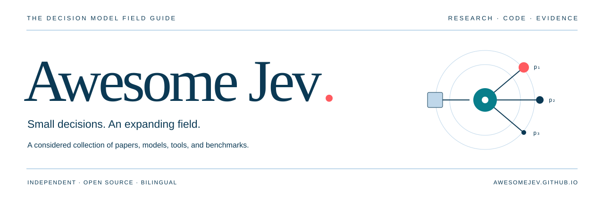

<p align="center">
  
</p>

<p align="center">
  <a href="https://awesomejev.github.io"></a>
  <a href="README.md"></a>
  <a href="docs/survey.zh-CN.md"></a>
  <a href="docs/source-audit.md"></a>
  <a href="https://github.com/AwesomeJev/AwesomeJev.github.io/actions/workflows/ci.yml"></a>
  <a href="LICENSE"></a>
</p>

<p align="center"><strong><a href="https://awesomejev.github.io/?lang=zh">浏览资源</a> · <a href="docs/survey.zh-CN.md">阅读综述</a> · <a href="README.md">English</a> · <a href="CONTRIBUTING.md">参与贡献</a></strong></p>

Jev 提出了一个具体的问题：**当模型直接返回代码可消费的决策，系统会发生什么变化？** Awesome Jev 围绕这个问题，整理研究论文、开发工具、开放实验与可检查的评测证据。

由 [AwesomeJev](https://github.com/AwesomeJev) 维护的独立社区项目，与 TypeSafe AI 无隶属关系。整理日期：**2026-10-15**。模型能力、别名、定价和榜单结果均有时间范围。

## 从这里开始

| 你的目标 | 阅读入口 |
| :--- | :--- |
| 理解基本概念 | [System One 与 Jev 发布文章](https://typesafe.ai/blog/introducing-system-one-models-and-jev) → [中文综述](docs/survey.zh-CN.md) |
| 了解开放生态 | **[Jev Decision Index](https://huggingface.co/spaces/multimodalart/jev-decision-index)** → [动态与复现项目](https://multimodalart-jev-decision-index.static.hf.space/news.html) |
| 开始开发 | [官方快速入门](https://docs.typesafe.ai/introduction/quickstart) → [Python SDK](https://github.com/typesafe-ai/typesafe-sdk-python) |
| 判断评测证据 | [直接研究](#直接研究) → [评测资源](#评测资源) → [复现方案](docs/survey.zh-CN.md) |
| 追溯相关技术 | [相关研究](#相关研究) · [BibTeX](references.bib) |

## 模型与接口

TypeSafe 将 Jev 称为 **System One 模型**：输入状态与类型化问题，返回限定空间中的决策和概率。核心接口有三个原语。[官方介绍](https://docs.typesafe.ai/introduction)

| 原语 | 典型用途 | 输出 |
| :--- | :--- | :--- |
| [Choice](https://docs.typesafe.ai/primitives/choice) | 分类、路由 | 选项、完整概率分布与 confidence；最多 255 个选项 |
| [Score](https://docs.typesafe.ai/primitives/score) | 按量表评分 | 描述等级上的概率加权分数、分布与 confidence |
| [Noul](https://docs.typesafe.ai/primitives/noul) | 判断命题是否成立 | [0, 1] 概率；没有独立 confidence 字段 |

类型合法、语义正确与概率校准是不同性质。[Confidence](https://docs.typesafe.ai/confidence) 是由输出分布计算的统计量，不能直接等同于实测正确率。

**版本说明。** 截至 2026-10-15，`jev-latest` 指向 `jev-1.13.0`，`jev-preview` 指向 `jev-1.14.0`；复现时应固定具体 ID。[图片输入](https://docs.typesafe.ai/images)与 1.14 的 [Box](https://docs.typesafe.ai/primitives/box) 属于需显式开启的实验能力，应与默认文本能力区分。[模型页面](https://docs.typesafe.ai/models) · [Jev 1.13 已知局限](https://docs.typesafe.ai/model-jaggedness/jev-1.13)

## 直接研究

以下均为 **arXiv 预印本**，链接固定到本项目核查的版本。结论由论文作者报告，收录不表示我们已经复现实验。

- **[Evaluating and Benchmarking the System One Model Jev](https://arxiv.org/abs/2609.37647v1)** — Deußer、Sparrenberg、Sifa，2026-09。覆盖 37 个数据集的分类与决策评测。[代码](https://github.com/AppliedMachineLearning-Lab/jev-benchmarking)
- **[Typed Decision Models: An Early Evidence Audit and Evaluation Checklist](https://arxiv.org/abs/2609.32160v1)** — Tang、Zheng，2026-09。早期证据与评测设计索引，可沿引用回到原始研究。
- **[JEV-as-a-Judge: Accept When Confident, Escalate When Unsure](https://arxiv.org/abs/2609.26550v5)** — Li 等，2026-10 修订。基于置信度的评判与升级处理。
- **[Decision Models vs. LLMs as Rubric Judges: Cheaper, Faster, and Wrong in the Same Places](https://arxiv.org/abs/2609.29769v3)** — Rao、Callison-Burch，2026-10 修订。量表评判、错误相关性及级联系统的收益边界。
- **[JEV versus LLMs: Accuracy, Cost and Calibration on Seven Political Science Replications](https://arxiv.org/abs/2610.06625v2)** — Denney、DiGiuseppe，2026-10。政治科学任务中的复现实验和成本比较。
- **[Same Attack, Different Judge](https://arxiv.org/abs/2610.17820v1)** — Li 等，2026-10。对 Jev、LLM judge 和安全分类器的受控对抗比较。

详见[证据对照与开放问题](docs/survey.zh-CN.md)，书目可导入 [references.bib](references.bib)。

<details>
<summary>更多直接研究</summary>

以下均为 **arXiv 预印本**，链接固定到所读版本；结论由论文作者报告。

- [this-that-model-1.0](https://arxiv.org/abs/2609.23886v1) · 2026-09-20 — 本地推理与显式概率读出的开放类型化决策模型。
- [Jev-Mem](https://arxiv.org/abs/2609.23986v1) · 2026-09-21 — 用决策模型控制记忆构建、检索与 agent 推理。
- [PixelJev](https://arxiv.org/abs/2609.29283v1) · 2026-09-24 — 分别评估视觉候选评分、模型适配与概率校准。
- [JevAdvBench](https://arxiv.org/abs/2609.31142v1) · 2026-09-25 — 将对抗请求扰动与原始决策、重复调用波动对照。
- [Beyond Calibration](https://arxiv.org/abs/2609.33209v1) · 2026-09-27 — 检验相关概率问题之间的逻辑一致性。
- [System One Models for Agent Security Decisions](https://arxiv.org/abs/2609.33401v3) · 2026-10-03 修订 — 研究高置信安全错误及非对称风险下的选择性自动化。
- [Sys1Cal-v1](https://arxiv.org/abs/2609.35342v1) · 2026-09-28 — 用构造的已知概率目标检验 Jev 各原语的校准。
- [Chinese-Jev](https://arxiv.org/abs/2609.36965v1) · 2026-09-29 — 面向中文通用及专业领域的决策训练与评估。
- [Jeva](https://arxiv.org/abs/2610.18773v1) · 2026-10-13 — 缺失答案处理、选项置换、可变候选集与选项表示复用。
- [System1-Arena](https://arxiv.org/abs/2610.21244v1) · 2026-10-15 — 以统一决策请求和闭环环境比较决策模型与推理模型。

</details>

## 评测资源

### Jev Decision Index

**[Decision Index](https://huggingface.co/spaces/multimodalart/jev-decision-index)** 是本项目重点跟踪的生态入口，覆盖 Jev 启发的模型、开放实验与比较结果。建议结合[评测方法](https://multimodalart-jev-decision-index.static.hf.space/methodology.html)、[动态](https://multimodalart-jev-decision-index.static.hf.space/news.html)和[源文件](https://huggingface.co/spaces/multimodalart/jev-decision-index/tree/main)阅读。

开放复现是各自独立的实现，不代表 TypeSafe 官方权重。榜单 Full score 包含未公开的私有测试，因此不能将“公开榜单”理解成“完整评测可复现”。

### 评测实现

| 资源 | 内容与范围 |
| :--- | :--- |
| [TypeSafe WorkflowEvals](https://github.com/typesafe-ai/WorkflowEvals) | 官方运行器、工作流、已发布运行与评分代码。[评测站](https://evals.typesafe.ai/) · [数据](https://huggingface.co/collections/typesafeAI/workflowevals) |
| [jev-benchmarking](https://github.com/AppliedMachineLearning-Lab/jev-benchmarking) | 上述 37 数据集论文的实验框架。 |
| [PavelRavvich / jev-bench](https://github.com/PavelRavvich/jev-bench) | 公共分类任务、逐条预测、校准、延迟、成本与级联分析；注意小样本和不同置信度接口。 |
| [AY Automate benchmark](https://www.ayautomate.com/blog/jev-vs-llm-benchmark) | 路由和注入检测，附代码与原始调用；应连同采样和推理配置一起阅读。 |

官方 WorkflowEvals 使用模型共识作为参考；与共识一致和对人类标签正确，是两个不同问题。比较速度或价格前，应对齐模型版本、任务、调用路径、概率接口和推理配置。[评测方法](https://evals.typesafe.ai/)

## 开发工具

### 开放模型实验

独立实现提供检验设计选择的机会。使用前应阅读模型卡中的许可、训练数据、评测设置和访问条件；这些并不是 TypeSafe 的模型权重。

| 模型 | 发布者 | 声明的许可 |
| :--- | :--- | :--- |
| [Laya](https://huggingface.co/convaiinnovations/laya) | Convai Innovations | Apache-2.0 |
| [Kev-4B](https://huggingface.co/jaredpalmer/kev-4b) | Jared Palmer | Apache-2.0 |
| [Bespoke Nimble 9B v3](https://huggingface.co/bespokelabs/Bespoke-Nimble-9B-v3) | Bespoke Labs | **CC BY-NC 4.0，限非商业用途** |
| [Intern-Decision-4B](https://huggingface.co/internlm/Intern-Decision-4B) | InternLM | Apache-2.0 |
| [Perplexity Decider v1.1 27B](https://huggingface.co/perplexity-ai/pplx-decider-v1.1-27b) | Perplexity | Apache-2.0；注意访问说明 |
| [GLiNER2.5-Decide](https://huggingface.co/fastino/GLiNER2.5-Decide) | Fastino | Apache-2.0 |
| [d3](https://huggingface.co/vllm-sr/d3) | vLLM Semantic Router | Apache-2.0 |
| [Clef](https://huggingface.co/Cloudflare/clef) | Cloudflare | Apache-2.0 |

### SDK 与集成

| 项目 | 用途 |
| :--- | :--- |
| [Python SDK](https://github.com/typesafe-ai/typesafe-sdk-python) | 官方同步与异步 Python 客户端。 |
| [TypeScript SDK](https://github.com/typesafe-ai/typesafe-sdk-js) | 官方 JavaScript / TypeScript 客户端。 |
| [System One Adapter](https://github.com/typesafe-ai/system-one-adapter-python) | 在可比较的类型化问题接口下接入 LLM 基线。 |
| [Public examples](https://github.com/typesafe-ai/typesafe-public-examples) | 官方示例与 cookbook 代码。 |
| [Agent skills](https://github.com/typesafe-ai/skills) | 编码 agent 的集成指南。 |
| [n8n nodes](https://github.com/typesafe-ai/n8n-nodes-typesafe-ai) | n8n 工作流集成。 |

### 第一个类型化决策

安装 `typesafe-sdk`，在环境中设置 `TYPESAFE_API_KEY`。下面采用官方 SDK 的接口，并固定模型版本；运行需要 API 权限并产生用量费用。本项目整理时未执行真实 API 调用。

```python
from typesafe_sdk import Choice, TypeSafeClient

with TypeSafeClient() as client:
    result = client.system_one(
        model="jev-1.13.0",
        state={"ticket": "I was charged twice. Please fix this."},
        questions={
            "category": Choice(
                instructions="What is this ticket about?",
                criteria={
                    "billing": "Charges, payments, or refunds",
                    "technical": "Bugs or technical failures",
                    "other": "None of the above",
                },
            )
        },
    )

answer = result.choices["category"]
print(answer.choice, answer.probabilities, answer.confidence)
```

安装方式和返回类型以[官方 SDK 文档](https://github.com/typesafe-ai/typesafe-sdk-python)为准。

## 实践指南

| 任务 | 入口 |
| :--- | :--- |
| 对不确定样本升级处理 | [Confidence-gated routing](https://docs.typesafe.ai/patterns/confidence-routing) |
| 多维度判断 | [Composite scoring](https://docs.typesafe.ai/patterns/composite-scoring) |
| 检查生成内容 | [LLM guardrails](https://docs.typesafe.ai/cookbooks/llm_guardrails) · [Citation checking](https://docs.typesafe.ai/cookbooks/citation_check) |
| 筛选检索片段 | [RAG passage classification](https://docs.typesafe.ai/cookbooks/classifying_rag_passages) |
| 遍历大型分类树 | [Hierarchical classification](https://docs.typesafe.ai/cookbooks/hierarchical_classification) |
| 选择候选抽取值 | [Pre-parsed value extraction](https://docs.typesafe.ai/cookbooks/pre_parsed_value_extraction_cookbook) · [日期](https://docs.typesafe.ai/cookbooks/date_extraction_cookbook) |

这些是厂商编写的配方。阈值需在留出数据上验证，算术、解析和业务规则尽量保留在代码中。

## 相关研究

这些工作提供背景和基线，不说明 Jev 实际采用了其中的架构、训练目标或采样器。

| 方向 | 精选文献 |
| :--- | :--- |
| 概率评分 | Gneiting、Raftery，**[Strictly Proper Scoring Rules, Prediction, and Estimation](https://doi.org/10.1198/016214506000001437)**，2007 |
| 概率校准 | Guo 等，**[On Calibration of Modern Neural Networks](https://proceedings.mlr.press/v70/guo17a.html)**，2017 |
| 选择性预测 | Geifman、El-Yaniv，**[SelectiveNet](https://proceedings.mlr.press/v97/geifman19a.html)**，2019 |
| LM 自我评估 | Kadavath 等，**[Language Models (Mostly) Know What They Know](https://arxiv.org/abs/2207.05221)**，2022 |
| 带约束的 LM 程序 | Beurer-Kellner 等，**[Prompting Is Programming](https://www.sri.inf.ethz.ch/publications/beurerkellner2023prompting)**，PLDI 2023 |
| 结构化生成 | Dong 等，**[XGrammar](https://arxiv.org/abs/2411.15100)**，2024 · [代码](https://github.com/mlc-ai/xgrammar) |
| 可组合流水线 | Khattab 等，**[DSPy](https://arxiv.org/abs/2310.03714)**，2023 |
| 高效执行 | Zheng 等，**[SGLang](https://papers.nips.cc/paper_files/paper/2024/file/724be4472168f31ba1c9ac630f15dec8-Paper-Conference.pdf)**，NeurIPS 2024 · [代码](https://github.com/sgl-project/sglang) |

## 来源核查

上面的精简列表经过编辑精选；更大的研究语料库保留获取出处、相关性信号和核查深度。**内容筛查不等于全文精读，也不等于实验复现。** 获取失败和仅有元数据的条目会单独标记。

查看[核查方法](docs/source-audit.md)、[来源数据](data/)，或在[网站](https://awesomejev.github.io/#corpus)搜索研究语料。收录不表示背书，模型和数据保留各自许可。

## 参与贡献

优质条目需要说明：**提供什么价值、核查了哪个版本、证据在哪里。** 详见 [CONTRIBUTING.md](CONTRIBUTING.md)，欢迎纠错和负面结果。

原创项目内容与代码采用 [MIT 许可](LICENSE)。外链论文、数据集、模型权重和第三方资源保留各自许可。
